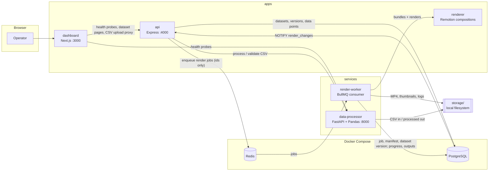

# Statsopedia

Semi-automated YouTube video generation for historical statistics, global rankings and data
visualization. Statsopedia turns versioned CSV datasets into long-form (16:9) and Shorts (9:16)
ranking videos rendered with [Remotion](https://www.remotion.dev/).

> **Status: studio.** Dataset management works end to end (CSV upload, validation with row
> numbers, versioned storage, rankings and animation-ready JSON, dashboard). The API manages users,
> topics, templates, media, video projects and render jobs: projects pin an immutable dataset
> version, renders are queued on BullMQ with job state in PostgreSQL, and progress streams over
> Server-Sent Events. The render worker loads each job from PostgreSQL, renders previews,
> long-form videos and Shorts with Remotion, validates them with FFmpeg and records outputs and
> metadata ([docs/render-worker.md](docs/render-worker.md)). The admin dashboard covers datasets,
> projects, the Video Studio with a live Remotion Player preview, the render queue and generated
> videos ([docs/dashboard.md](docs/dashboard.md)). Publishing is not built (see
> [Known limitations](#known-limitations)).

---

## Architecture



| Principle                  | How it is applied                                                                                                                                                       |
| -------------------------- | ----------------------------------------------------------------------------------------------------------------------------------------------------------------------- |
| Independently deployable   | Every app/service has its own `package.json` (or Python requirements), `.env.example`, config validation, start script and tests. Nothing imports another app's source. |
| Renderer isolation         | `apps/renderer` depends only on shared packages. All input arrives as Remotion input props; it never calls the API or database.                                         |
| Database as record         | A render job carries only ids. The worker loads the pinned manifest and immutable dataset version from PostgreSQL, checks the props checksum and records its own state. |
| Contracts first            | `shared-types` (TypeScript) and `shared-schemas` (Zod) describe every entity; the Python service mirrors them and the API validates its output with the Zod schemas.    |
| Fail fast, report honestly | Invalid configuration stops a service at start-up. Readiness endpoints return `503` with the real dependency error rather than a fake success.                          |

## Repository layout

```
apps/
  api/                Express API: health, /api/datasets, migrations, render-queue producer
  dashboard/          Next.js App Router admin dashboard (signed-in users; proxies the API)
  renderer/           Remotion compositions (SampleLong, SampleShort)
services/
  data-processor/     FastAPI + Pandas: CSV validation, rankings, interpolation, normalized JSON
  render-worker/      BullMQ worker that renders compositions to storage/renders
packages/
  shared-types/       Zero-dependency TypeScript contracts + enum constants
  shared-schemas/     Zod validators for every contract (use at all external boundaries)
  video-config/       Video defaults, resolution presets, themes, timeline maths
  chart-components/   BarChartRace components (Remotion) + pure race model, ranking and layout
  ui/                 Dashboard design tokens + server-component-safe primitives
  utils/              `@statsopedia/utils` (isomorphic) and `@statsopedia/utils/node` (logger, env, storage)
docker/redis/         Redis config for BullMQ (noeviction, AOF persistence)
samples/datasets/     Synthetic sample CSV (also the source of the cross-language contract fixtures)
storage/              Local datasets, assets and renders (contents git-ignored)
compose.yaml          PostgreSQL + Redis with health checks and persistent volumes
```

Dependency direction between packages (no cycles):

```
shared-types ← shared-schemas ← video-config
shared-types ← utils ← chart-components
ui (standalone)
```

## Prerequisites

| Tool                | Version                                     | Notes                                                                                                   |
| ------------------- | ------------------------------------------- | ------------------------------------------------------------------------------------------------------- |
| Node.js             | ≥ 22.12 (24 LTS recommended, see `.nvmrc`)  | Developed on Node 25.8.                                                                                 |
| pnpm                | ≥ 10.16                                     | `corepack enable` picks up the pinned version from `packageManager`.                                    |
| Python              | ≥ 3.11                                      | For `services/data-processor` (developed on 3.13).                                                      |
| Docker + Compose v2 | recent (verified: Engine 29.9, Compose 5.7) | Runs PostgreSQL and Redis locally. On macOS, start Docker Desktop first (`open -a Docker`).             |
| FFmpeg              | optional today                              | Remotion ships its own FFmpeg for rendering. A system FFmpeg will be needed for future post-processing. |

The first render downloads Chrome Headless Shell (~100 MB) into the package's
`node_modules/.remotion` directory.

## Installation

```bash
# 1. Install JS dependencies
corepack enable
pnpm install

# 2. Create local environment files and replace every `change-me`
cp .env.example .env                                    # Compose: Postgres + Redis credentials
cp apps/api/.env.example apps/api/.env                  # must match the root .env passwords
cp services/render-worker/.env.example services/render-worker/.env
cp services/data-processor/.env.example services/data-processor/.env
cp apps/dashboard/.env.example apps/dashboard/.env.local

# 3. Start infrastructure (waits until both health checks pass)
pnpm infra:up

# 4. Create the Python virtualenv for the data-processor
pnpm setup:python

# 5. Build the shared packages (apps consume their compiled output)
pnpm build:packages

# 6. Create the database schema (idempotent; re-run after pulling new migrations)
pnpm --filter @statsopedia/api db:migrate

# 7. Seed the template, topics and users (idempotent; never changes an existing password).
#    Set SEED_ADMIN_EMAIL / SEED_ADMIN_PASSWORD in apps/api/.env first, and optionally
#    SEED_DASHBOARD_EMAIL / SEED_DASHBOARD_PASSWORD for an extra editor account.
#    Sign in to the dashboard with either. Passwords need at least 12 characters.
pnpm --filter @statsopedia/api db:seed
```

### End-to-end check

With the infrastructure up and the seed applied, `pnpm dev:api` and `pnpm dev:worker` running,
follow [Project and render check](#project-and-render-check) below. For an automated check of
the whole pipeline with real rendering:

```bash
RENDER_E2E=1 TEST_DATABASE_URL=postgres://statsopedia:<password>@127.0.0.1:5432/statsopedia_test \
TEST_REDIS_URL=redis://:<password>@127.0.0.1:6379 \
  pnpm --filter @statsopedia/api test render.e2e
```

### Dataset check

With the API (`pnpm dev:api`) and data-processor (`pnpm dev:data-processor`) running. Every
`/api` call needs a token (see [docs/api.md](docs/api.md#authentication)):

```bash
TOKEN=$(curl -s -X POST 127.0.0.1:4000/api/auth/login -H 'content-type: application/json' \
  -d "{\"email\":\"$SEED_ADMIN_EMAIL\",\"password\":\"$SEED_ADMIN_PASSWORD\"}" \
  | node -pe 'JSON.parse(require("fs").readFileSync(0)).token')
ID=$(curl -s -X POST 127.0.0.1:4000/api/datasets -H "authorization: Bearer $TOKEN" \
  -H 'content-type: application/json' -d '{"title":"Synthetic ranking"}' \
  | node -pe 'JSON.parse(require("fs").readFileSync(0)).id')
curl -s -X POST "127.0.0.1:4000/api/datasets/$ID/import?filename=sample.csv" \
  -H "authorization: Bearer $TOKEN" \
  -H 'content-type: text/csv' --data-binary @samples/datasets/synthetic-ranking.csv
open "http://127.0.0.1:3000/datasets/$ID"   # with `pnpm dev:dashboard` running
```

### Project and render check

With the API, data-processor and render worker running and a ready dataset version:

```bash
H="authorization: Bearer $TOKEN"
TEMPLATE=$(curl -s 127.0.0.1:4000/api/templates -H "$H" | node -pe 'JSON.parse(require("fs").readFileSync(0)).templates[0].id')
VERSION=$(curl -s 127.0.0.1:4000/api/datasets/$ID -H "$H" | node -pe 'JSON.parse(require("fs").readFileSync(0)).latestVersion.id')
PROJECT=$(curl -s -X POST 127.0.0.1:4000/api/projects -H "$H" -H 'content-type: application/json' \
  -d "{\"name\":\"Test\",\"configuration\":{\"datasetVersionId\":\"$VERSION\",\"templateId\":\"$TEMPLATE\",\"outputMode\":\"short\"}}" \
  | node -pe 'JSON.parse(require("fs").readFileSync(0)).id')
JOB=$(curl -s -X POST 127.0.0.1:4000/api/projects/$PROJECT/preview -H "$H" -H 'Idempotency-Key: first-preview' \
  | node -pe 'JSON.parse(require("fs").readFileSync(0)).request.jobs[0].id')
curl -N 127.0.0.1:4000/api/jobs/$JOB/events -H "$H"   # progress until `event: end`
```

## Development commands

Run from the repository root.

| Command                                                            | What it does                                                                   |
| ------------------------------------------------------------------ | ------------------------------------------------------------------------------ |
| `pnpm dev:api`                                                     | API with reload on `:4000` (pretty logs)                                       |
| `pnpm dev:dashboard`                                               | Dashboard on `:3000`                                                           |
| `pnpm dev:renderer`                                                | Remotion Studio on `:3100`                                                     |
| `pnpm dev:worker`                                                  | Render worker with reload (pretty logs)                                        |
| `pnpm dev:data-processor`                                          | FastAPI with reload on `:8000`                                                 |
| `pnpm --filter "./packages/**" --parallel dev`                     | Rebuild shared packages on change                                              |
| `pnpm render:sample` / `pnpm render:sample:short`                  | Render the sample composition via the Remotion CLI                             |
| `pnpm --filter @statsopedia/renderer render:race` (`:short`)       | Render the synthetic BarChartRace (16:9 / 9:16) with music, plus a sidecar     |
| `pnpm --filter @statsopedia/renderer sample:data` / `sample:music` | Regenerate the synthetic race dataset (via the data-processor) / the music pad |
| `pnpm --filter @statsopedia/api db:migrate`                        | Apply pending SQL migrations (`apps/api/migrations`); refuses edited ones      |
| `pnpm --filter @statsopedia/api db:seed`                           | Seed the template, topics, admin and dashboard users (idempotent)              |
| `pnpm --filter @statsopedia/api media:analyze`                     | Measure music uploaded before analysis (length, loudness, true peak)           |
| `pnpm build`                                                       | Build every workspace in dependency order                                      |
| `pnpm lint`                                                        | ESLint (whole monorepo) + Ruff (data-processor)                                |
| `pnpm typecheck`                                                   | Build packages, then `tsc --noEmit` everywhere + mypy (strict)                 |
| `pnpm test`                                                        | Build packages, then Vitest everywhere + pytest                                |
| `pnpm format` / `pnpm format:check`                                | Prettier                                                                       |
| `pnpm check`                                                       | format check + lint + typecheck + test                                         |
| `pnpm infra:up` / `infra:down` / `infra:logs` / `infra:config`     | Docker Compose helpers                                                         |

## Services

| Service        | Path                      | Port            | Health                                                                            | Needs                                                      |
| -------------- | ------------------------- | --------------- | --------------------------------------------------------------------------------- | ---------------------------------------------------------- |
| API            | `apps/api`                | 4000            | `GET /health` (liveness), `GET /health/ready` (Postgres + Redis, `503` when down) | Postgres, Redis                                            |
| Dashboard      | `apps/dashboard`          | 3000            | `GET /api/health`                                                                 | API + data-processor URLs (optional; shown as unreachable) |
| Data processor | `services/data-processor` | 8000            | `GET /health`, `GET /health/ready` (storage directories writable)                 | storage                                                    |
| Render worker  | `services/render-worker`  | —               | No HTTP endpoint; structured logs + BullMQ job state                              | Redis, storage, renderer source                            |
| Renderer       | `apps/renderer`           | 3100 (Studio)   | n/a (library of compositions)                                                     | —                                                          |
| PostgreSQL     | `compose.yaml`            | 5432 (loopback) | `pg_isready`                                                                      | —                                                          |
| Redis          | `compose.yaml`            | 6379 (loopback) | `redis-cli ping`                                                                  | —                                                          |

Every service starts without its dependencies and reports them as down, so they can be developed
and deployed independently.

**API.** `createApp(deps)` receives its logger, readiness checks and service info by injection,
so tests run without PostgreSQL or Redis. The render-queue producer validates payloads with
`renderJobPayloadSchema` and uses the render job id as the BullMQ job id, so enqueueing is
idempotent. Its render monitor listens for `NOTIFY render_changes` (for Server-Sent Events) and
records what a dead worker cannot: crashes, lost queue entries, cancellations.

**Render worker.** Loads each job, its pinned manifest and immutable dataset version from
PostgreSQL, verifies assets and the props checksum, renders with Remotion in an isolated temp
directory, post-processes and validates with FFmpeg (faststart, loudness, ffprobe, full decode),
publishes files without ever overwriting one, and records progress, the output and render
metadata itself. Failures are classified as retryable or permanent; crashes are recovered by
another worker. One production render at a time by default. Details:
[docs/render-worker.md](docs/render-worker.md). Restart the worker after changing renderer code
(the bundle is cached).

**Renderer.** `SampleLong` (16:9) and `SampleShort` (9:16) animate a ranking of clearly labelled
**synthetic** data. `calculateMetadata` validates the input props with Zod and derives width,
height, fps and duration from `@statsopedia/video-config`. Bar colors are assigned per entity
(never per rank) from palettes validated for colour-vision deficiency against each theme's
background.

**Data processor.** Internal FastAPI service (binds to `127.0.0.1`; the API is its only client).
Processing is split into independent, unit-tested modules under `app/processing/`: `ingest`
(CSV parsing), `validate`, `ranking`, `interpolation`, and `pipeline`, which wires them together.
Endpoints: `POST /validate`, `POST /process/csv`, `POST /rankings` and `GET /health`. File paths
in requests must stay inside `storage/datasets`, `storage/temp` (sources) or `storage/processed`
(outputs); symlinks out of storage are refused.

## Datasets

### CSV format

UTF-8 (a byte-order mark is fine), comma-separated, RFC 4180 quoting: commas, quotes and line
breaks are allowed inside quoted fields. One row is one entity's value at one time point. Header
names are matched case-insensitively.

| Column            | Required | Notes                                                                      |
| ----------------- | -------- | -------------------------------------------------------------------------- |
| `entity_id`       | yes      | Stable id, kept exactly as written (e.g. `USA`); max 120 characters        |
| `entity_name`     | yes      | Must be identical on every row of the same `entity_id`                     |
| `year`            | yes      | `2020` / `-500` (yearly), `2020-03` (monthly) or `2020-03-15` (daily)      |
| `value`           | yes      | Plain or scientific notation. **Empty = missing observation, never zero.** |
| `unit`            | yes      | One unit per file                                                          |
| `source_id`       | yes      | Source key, shared across datasets (e.g. `world-bank-wdi`)                 |
| `entity_image`    | no       | http(s) URL                                                                |
| `entity_category` | no       | Free text; also sets the entity type when it is `country`, `company`, …    |
| `source_url`      | no       | http(s) URL                                                                |
| `notes`           | no       | Free text, max 2,000 characters                                            |

Yearly periods use ISO 8601 astronomical numbering (year 0 is 1 BCE). The dataset's
`metric.frequency` decides which period format is accepted.

### Validation

Every issue carries the CSV row number (header = row 1; a quoted multi-line field still counts as
one row). Rows are never dropped silently: each row is either a valid observation or the subject of
at least one error. **Errors** block the import; **warnings** are reported and the import goes on.

| Errors (blocking)                                                                                                                                                                                                                                                                         | Warnings                                                                                                                                                                                                                                     |
| ----------------------------------------------------------------------------------------------------------------------------------------------------------------------------------------------------------------------------------------------------------------------------------------- | -------------------------------------------------------------------------------------------------------------------------------------------------------------------------------------------------------------------------------------------- |
| Not UTF-8, binary, empty or malformed file; missing or duplicate columns; wrong field count (unquoted comma); missing id/name/year/unit/source; invalid id; invalid period or number; negative value when not allowed; duplicate `entity_id` + `year`; mixed units; one id with two names | Unknown columns (ignored); blank rows; empty values; missing periods per entity; periods with no data at all; invalid or conflicting `entity_image` / `source_url` / category; unit differs from the dataset's; gaps too long to interpolate |

### Rankings and interpolation

- Rankings are computed per calendar period, **descending by default** (`metric.rankingOrder`).
- **Ties:** tied values share a competition rank (1, 2, 2, 4) and are ordered by entity id
  (`position`), so output is identical whatever the row order.
- Entities enter and leave the ranking freely; each period lists `entered` and `exited` ids.
- Missing values are left unranked unless `processing.missingValues` is `zero`, which ranks them
  as 0 between the entity's first and last row only.
- `processing.topN` keeps the top N per period (null keeps every entity).
- **Interpolation** (`linear` or `none`) builds animation frames: `stepsPerPeriod` frames per
  period transition. Gaps of up to `maxGapPeriods` missing periods are bridged; longer gaps need
  `allowLargeGaps`. Values are never extrapolated. Interpolated values are marked `interpolated`
  and their frames `isEstimate`; original observations are never changed.

### Normalized output

`storage/processed/<datasetId>/<versionId>.json` (`DatasetVersion.processedFilePath`) is the
animation-ready `NormalizedDataset` (see `packages/shared-types/src/processing.ts`): dataset
metadata, metric configuration (with unit), processing options, time range with every period,
entities (with their missing periods), sources, the original observations with row numbers,
rankings by period, interpolation metadata (bridged and skipped gaps), frames, and the data
quality summary with warnings. The full validation report sits next to it as `.report.json`.
Responses include at most 1,000 issues; counts and the report file are always complete.

The API re-validates every file the processor writes against the Zod schema before importing it,
and `packages/shared-schemas/test/fixtures/` holds files generated by the Python processor from
`samples/datasets/synthetic-ranking.csv`. TypeScript tests parse them with the Zod schemas, and a
Python test fails if they are stale (`.venv/bin/python -m app.contract_fixtures` regenerates them).

### API

Dataset endpoints (create, list, import, validate, preview, versions, reprocess) are documented
with the rest of the API in [docs/api.md](docs/api.md#datasets). An import returns `201` even when
the CSV is invalid: the version is recorded with `validationStatus: "invalid"` and its report.

### Versions and the database

- An upload is stored unchanged as `storage/datasets/<datasetId>/<versionId>.csv`. The name is
  generated by the server; the client filename is sanitized and kept only as metadata.
- **Version numbering is atomic:** the dataset row is locked while the next number is assigned,
  and `UNIQUE (dataset_id, version)` is the backstop.
- **Imports are transactional:** sources, entities, data points, the version's final status and
  the dataset's latest version are written in one transaction, so a version's data is all there or
  not at all.
- Versions are never edited. Reprocessing creates a new version that points at the same original
  file (its checksum is verified first) and records the settings it used.
- Tables: `datasets`, `dataset_versions`, `data_entities`, `data_points` (original observations
  only), `data_sources` and `dataset_sources`. Name columns use ICU collation.
- A version left in `processing` by a crash is marked failed when the API next starts.

### Upload security

Size limit enforced while reading the body (`MAX_UPLOAD_BYTES`, default 50 MB; `413`). Only
`.csv` names and text content types are accepted, and binary content is rejected (`415`). Storage
keys are server-generated from UUIDs (`storageKeys` in `@statsopedia/utils/node`) and resolved
by `LocalStorage`, which refuses traversal and symlinks out of storage. The database stores only
relative keys, and API responses never contain them. Uploaded files are read as data only and never executed. Every parameter, query string
and body is validated with Zod (`400`). The browser uploads through the dashboard's
`/api/datasets/:id/{import,validate}` route, so the API is never exposed to it directly; the
dashboard forwards it with the signed-in user's session.

## Configuration

- Each service owns a `.env.example` next to its code; copy it to `.env` (`.env.local` for the
  dashboard). Real environment variables always override file values.
- Configuration is validated at start-up (Zod in TypeScript, pydantic-settings in Python). Invalid
  or missing values stop the service with a message naming every bad variable.
- Credentials (`DATABASE_URL`, `REDIS_URL`, Compose passwords) have **no defaults** anywhere.
  Compose refuses to start without them (`${VAR:?}`); ports are bound to `127.0.0.1` only.
- Relative paths (`STORAGE_ROOT`, `RENDERER_ENTRY_POINT`) resolve against the service's own
  directory, which is the working directory when started via `pnpm`.

## Shared contracts

| Need                                    | Use                                                                                                                                                                                                                                                |
| --------------------------------------- | -------------------------------------------------------------------------------------------------------------------------------------------------------------------------------------------------------------------------------------------------- |
| Types only (no runtime cost)            | `@statsopedia/shared-types` — `Dataset`, `DatasetVersion`, `DatasetEntity`, `DataPoint`, `DataSource`, `VideoTemplate`, `VideoProject`, `VideoConfiguration`, `RenderJob`, `VideoOutput`, `MediaAsset`, plus queue payload/result and health types |
| Validate external input                 | `@statsopedia/shared-schemas` — a Zod schema per type (`videoConfigurationSchema`, …)                                                                                                                                                              |
| Build a configuration / render settings | `@statsopedia/video-config` — `createVideoConfiguration`, `resolveDimensions`, `computeTimeline`, `VIDEO_THEMES`                                                                                                                                   |

Every schema is declared with `satisfies z.ZodType<T>`, and `shared-schemas/test/type-parity.test.ts`
asserts exact equality between each schema's output and its shared type, so `pnpm typecheck` fails
if they drift apart.

`VideoConfiguration` covers title and description (YouTube limits enforced), dataset version,
template, start/end years, top N, animation speed, theme, output formats, music asset and volume,
fps, resolution, and intro/outro configuration.

## Conventions

- **Imports.** Cross-package: `@statsopedia/<package>` only. Inside the dashboard: `@/…` →
  `src/…`. Elsewhere: relative imports. Node packages use NodeNext ESM, so relative imports
  carry a `.js` extension; bundled apps (dashboard, renderer) use extensionless imports.
- **TypeScript.** `strict`, `noUncheckedIndexedAccess`, `noImplicitOverride`,
  `verbatimModuleSyntax` (see `tsconfig.base.json`). Type-aware ESLint (`typescript-eslint`
  recommended-type-checked) plus Next.js, React Hooks and Remotion rules.
- **Logging.** One JSON object per line with `level`, `time` (ISO-8601), `service`, `msg` plus
  structured fields — pino in Node (`createLogger` from `@statsopedia/utils/node`), a matching
  formatter in Python. Secrets and connection URLs are never logged.
- **Storage paths.** Persist paths relative to the storage root; turn them into absolute paths
  only via `resolveStoragePath`, which rejects traversal outside the root.
- **Versions.** Shared versions live in the `catalog:` of `pnpm-workspace.yaml`. Remotion
  packages must all share one exact version, and `zod` must match the version that Remotion
  release expects (the Remotion CLI warns otherwise).

## Storage layout

```
storage/
  datasets/          uploaded CSVs (immutable, versioned)
  processed/         data-processor output
  assets/{logos,music,fonts,images}/   uploaded media (served to renders by the worker)
  renders/{previews,long,shorts}/   <projectId>_<format>_v<version>[_preview].mp4
  thumbnails/        one JPEG per video, same name
  logs/              render log per video (NDJSON, every attempt)
  temp/renders/<jobId>/   a job's working directory, removed after every attempt
```

The directory skeleton is committed (`.gitkeep`); file contents are git-ignored. The API and
worker create any missing directories at start-up.

## Video rendering (BarChartRace)

`BarChartRace` (in `packages/chart-components`) renders a `NormalizedDataset` with a
`BarChartRaceConfig` (`packages/shared-types/src/race.ts`). It never fetches data: both arrive as
props, validated by `barChartRacePropsSchema` in Remotion's `calculateMetadata` before a frame is
rendered, so an invalid config or an unknown period fails the render with a precise error.

```bash
pnpm --filter @statsopedia/renderer sample:music     # once: generates the licence-free pad
pnpm --filter @statsopedia/renderer render:race      # storage/renders/previews/synthetic-race.mp4 (+ .json)
pnpm --filter @statsopedia/renderer dev              # Remotion Studio: BarChartRace, BarChartRaceShort

# Any dataset and config:
pnpm --filter @statsopedia/renderer exec tsx scripts/render-race.ts \
  --dataset <normalized.json> --config <config.json> --out <file.mp4> [--music <music.json>] [--format short]
```

**How it is built.** The pure logic is framework-free and unit-tested; the Remotion components
only draw what it returns.

| Concern           | Where                                 | What it does                                                                                                         |
| ----------------- | ------------------------------------- | -------------------------------------------------------------------------------------------------------------------- |
| Timeline          | `video-config/src/race-timeline.ts`   | Frames ↔ periods: intro, per-period hold + eased transition, final hold (last chart frame = last period), outro      |
| Keyframes         | `chart-components/src/race/model.ts`  | One keyframe per period from the processor's frames: observations, zero-fills and its gap estimates, unchanged       |
| Interpolation     | `chart-components/src/ranking.ts`     | Values move linearly; ranks recomputed at sub-keyframes so bars swap when values cross; enter/exit from below        |
| Number formatting | `utils/src/format.ts`                 | Currencies, percent, integers, K/M/B/T or "million", custom prefix/suffix, ~3 significant digits for steady counters |
| Layout            | `chart-components/src/race/layout.ts` | Row height from top N; every size scales with the frame (720p–4K, landscape and portrait)                            |

**Visual rules.** Entities keep one color for the whole video (by id, never by rank), so with
more than 8 entities colors repeat and identity relies on the always-present name and monogram.
Ties share a rank ("2=") and are ordered by entity id, matching the data-processor. The leader
gets an accent rank and a soft glow. Values estimated by the processor across short gaps are
marked "est."; missing values are not shown (the entity leaves and re-enters); zeros show as an
empty bar with "$0"; a period with no data shows "No data for …". The bar scale is weighted so a
large entrant rescales the chart smoothly across the transition instead of snapping.

**Determinism.** Every frame is a pure function of the frame number and props. Inter (OFL) is
served from `apps/renderer/public/fonts/` through `staticFile()`, which works the same in Studio,
CLI renders and the render worker, so text renders identically without network access. Refresh
the files from `@fontsource/inter` with `pnpm --filter @statsopedia/renderer fonts:sync`. Rendering uses Chrome's software GL (`swangle`, set in `remotion.config.ts` and the render
worker): the GPU backend anti-aliased a few edge pixels differently between runs. Two full
renders of the sample are byte-identical MP4s. Software rendering is about 3.5× slower (sample:
~2 min instead of ~35 s); pass `--gl=angle` to the Remotion CLI for quick, non-reproducible
previews.

**Music.** Optional `config.music` (`src` in `apps/renderer/public/`, an http(s) URL or an
uploaded `storage:assets/…` file; `volume` ≤ 1, so it is never amplified; fades; `loop`;
`durationSeconds`; and the credit line when the license requires one). A shorter track repeats
with crossfades, and the music fades to silence on the last frame. Licensing metadata stays out
of the composition. For `render:race` it goes from the music manifest into the sidecar
`<video>.mp4.json`; for API renders it goes into the render manifest. The sample pad is
generated from sine waves (CC0, peak −12 dBFS, seamless 20 s loop).

**Storytelling.** Intro (branding, title, metric description, period), the race with sourced
editorial annotations (milestones, ranking changes, winners, new entries, big changes,
captions), the final ranking with the winner and an end card, and a source credits scene.
Annotation placement, music layout and the quality checks are pure functions shared by the
Studio, the API and the worker. See [docs/storytelling.md](docs/storytelling.md).

## Testing

| Workspace                                 | Tests                                                                                                                                                                                             |
| ----------------------------------------- | ------------------------------------------------------------------------------------------------------------------------------------------------------------------------------------------------- |
| shared-schemas                            | Schema behaviour, type parity, and Python-generated contract fixtures parsed by Zod                                                                                                               |
| video-config, utils, chart-components, ui | Timelines and frame↔period mapping, easing, number formatting, race keyframes, entry/exit, ties, scale smoothness, ticks, annotations, music volume                                               |
| api                                       | Health, errors, config, passwords, rate limits, media sniffing, upload safety; integration suites against PostgreSQL and Redis (see below)                                                        |
| render-store                              | Request types and aggregate status/progress                                                                                                                                                       |
| render-worker                             | Processor outcomes (retry, permanent, cancel, shutdown, timeout), error classes, no-clobber publish, temp isolation, MP4/ffprobe/loudness parsing, output checks, orphaned browsers, asset server |
| renderer                                  | Composition metadata (size, fps, duration, sub-ranges) and rejection of invalid race input                                                                                                        |
| dashboard                                 | API client (contract validation, error details), CSRF origin check, route protection, queue status groups, formatting, health probing, env parsing                                                |
| data-processor                            | Ingestion, validation, rankings, interpolation, endpoints, path safety, a 60,000-row file, fixtures                                                                                               |

The API's integration suites build the real app with real queues, the real render worker
runtime (only Remotion and FFmpeg replaced) and temporary storage. They cover:

- datasets: migrations, atomic version numbering under concurrent uploads, import rollback,
  reprocessing, upload limits
- auth and roles; topics, templates and media
- projects, including optimistic locking
- render orchestration: "both" requests, previews, idempotency under concurrent submissions,
  duplicate prevention, cancellation (queued, active, whole requests, during retries), retries,
  invalid outputs, permanent failures, changed dataset files, crash recovery, the PostgreSQL
  transition trigger, and both SSE streams with resume

`render.e2e.test.ts` renders for real (Remotion, Chrome, FFmpeg) when `RENDER_E2E=1` is also
set; see [docs/render-worker.md](docs/render-worker.md#tests).

They run when `TEST_DATABASE_URL` and `TEST_REDIS_URL` are set. Each run uses a fresh random
schema and BullMQ prefix and removes them afterwards. Without the variables the suites are
skipped:

```bash
TEST_DATABASE_URL=postgres://statsopedia:<password>@127.0.0.1:5432/statsopedia_test \
TEST_REDIS_URL=redis://:<password>@127.0.0.1:6379 \
  pnpm --filter @statsopedia/api test
```

## Supply-chain safeguards

- `minimumReleaseAge: 10080` — pnpm only resolves package versions that have been public for at
  least 7 days. Python pins were chosen by the same rule.
- `onlyBuiltDependencies` — only the listed packages may run install scripts.
- `overrides.schema-utils` — works around an incorrect webpack peer range in `schema-utils`
  4.8.0–4.8.2; remove once 4.8.3+ clears the release-age window.

## Known limitations

- **Dashboard sign-ins share the API's per-IP login limit** (50 per 15 minutes), because the
  dashboard server makes every sign-in call. The per-account limit still applies per user.
- **Dashboard notifications are per browser tab.** They come from the live queue stream and are
  not stored; reloading clears them.
- **No user-management endpoints.** Users are created by `db:seed`. There is no sign-up,
  password change or role editing through the API.
- **Rate limits are kept in memory** in each API process. Move them to Redis before running
  more than one API instance.
- **Run the job monitor's reconciliation in one API instance** (`JOB_MONITOR_ENABLED=true`;
  `false` elsewhere). Every instance streams progress from PostgreSQL notifications.
- **Render resource metrics cover the worker process only.** CPU time and peak memory in render
  metadata exclude Chrome, which renders in its own processes.
- **Orphaned browsers are reaped only at worker start-up**, and not when the worker is PID 1 or
  on Windows (see [docs/render-worker.md](docs/render-worker.md#crashes-and-recovery)).
- **Remote logos and images need network access during rendering** and fail the render if they
  cannot load. Store logos under `apps/renderer/public/` for reproducible renders.
- **Colors repeat beyond 8 entities** (the validated palette has 8 hues); labels and monograms
  carry identity. Per-entity colors (`DatasetEntity.color`) are not wired into the race yet.
- **CSV processing runs inside the import request.** 100,000 rows take about 4 s end to end; much
  larger files would be better served by a queued job. The processor accepts up to 1,000,000 rows
  and frames are capped at 2,000,000 ranked entries per version.
- **Uploads are buffered in memory** up to `MAX_UPLOAD_BYTES` before being written to storage.
- **Data sources are created from `source_id` only.** Their name equals the key; there is no
  endpoint yet to add publisher, license or access date.
- **No dataset editing or deletion endpoints.** Configuration is set at creation; reprocessing
  can override it per version.
- **No container images for the apps.** Compose runs infrastructure only; services run on the host.
- **The render worker has no HTTP health endpoint.** The dashboard's settings page shows API and
  data-processor health; worker activity is visible in the render queue.
- **Ctrl+C during a render is not graceful.** Remotion's `SIGINT` handler exits the process
  immediately (code 130), so the job cannot be handed back; another worker recovers it as stalled
  about 90 s later. `SIGTERM` (`docker stop`, Kubernetes, `kill`) is graceful.
- **PostgreSQL's default collation sorts by code point** (the Alpine image has no system
  locales). Name columns in the migrations use ICU collation (`und-x-icu`); keep doing that for new
  text columns that are sorted for people.
- **The data-processor scripts assume a POSIX virtualenv layout** (`.venv/bin`). On Windows, run
  the equivalent `.venv\Scripts` commands.
- **Upstream peer warnings on install.** `eslint-config-next`'s bundled plugins
  (`eslint-plugin-react`, `-import`, `-jsx-a11y`) and `@remotion/eslint-plugin` declare peer
  ranges that stop at ESLint 9. They run correctly on ESLint 10 (ESLint 9 is end-of-life), and
  `pnpm lint` passes.
