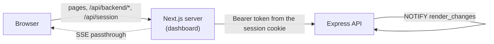

# Admin dashboard

`apps/dashboard` is the Statsopedia studio: a Next.js App Router application for datasets, video
projects, the Video Studio, the render queue and generated videos. Every screen reads the real
API; nothing is hard-coded.

```bash
pnpm dev:api            # :4000
pnpm dev:worker         # renders
pnpm dev:data-processor # CSV imports
pnpm dev:dashboard      # http://localhost:3000 — sign in with a seeded account
```

## Architecture



- **Sessions.** `/api/session` exchanges email and password for an API session. The token goes
  into an `httpOnly`, `SameSite=Lax` cookie (`Secure` in production). The page never sees the
  token.
- **API proxy** (`/api/backend/<path>` → `<API_BASE_URL>/api/<path>`). It streams bodies and
  responses: CSV and media uploads, ranged video and audio downloads, Server-Sent Events. It
  forwards only an allow-list of headers. It refuses cross-site writes (an `Origin` check, on top
  of `SameSite`), `..` paths and the API's login route. The API stays on a private address and
  does all validation and authorization.
- **Route protection.**
  - `src/proxy.ts` (Next 16's middleware) sends visitors without a session cookie to `/login`.
  - The dashboard layout checks the session against `GET /api/auth/me` on every full load. An
    expired session goes back to sign-in.
  - Any API call answered with `401` does the same.
- **Data.**
  - React Query owns all server state. Queries call typed functions (`src/lib/api/endpoints.ts`)
    that parse every response with the shared Zod schemas.
  - The dashboard never re-implements the API's validation: forms send what the user entered
    and show the API's errors, including field-level issues.
  - Global state is limited to two small contexts: the live queue (notifications) and
    breadcrumb labels.
- **Live updates.**
  - One `EventSource` on `GET /api/jobs/events` updates the cached queue and job details in
    place, refreshes affected projects, outputs and stats, and raises notifications.
  - Job details stream their own log from `GET /api/jobs/:id/events`.
  - Nothing polls for render progress. Overview stats refresh every minute; service health
    every 30 s.

## Screens

| Screen           | What it does                                                                                                                                                                                                                                                                                   |
| ---------------- | ---------------------------------------------------------------------------------------------------------------------------------------------------------------------------------------------------------------------------------------------------------------------------------------------- |
| Overview         | Totals (datasets, projects, completed renders, pending and failed jobs), recent projects, live rendering activity, storage usage per area and volume free space                                                                                                                                |
| Topics           | List with dataset and project counts; create                                                                                                                                                                                                                                                   |
| Datasets         | Search and topic filter; create, then upload                                                                                                                                                                                                                                                   |
| Dataset          | Version picker; overview; **Upload & validate** (validate only, or import as a new version, with the full report); validation issues (paged); version history; **ranking preview** with a period slider, top-N, an entity filter (also filters records server-side) and a historical rank grid |
| Video Projects   | Status filter; open in Studio, duplicate, delete drafts (with confirmation)                                                                                                                                                                                                                    |
| New project      | Dataset → version (ready ones only), template, period range, top N, speed, dark theme, output formats; save as draft or open in Studio                                                                                                                                                         |
| Project          | Renders (requests with aggregate progress and per-format jobs), videos, configuration; render preview or final, duplicate, delete                                                                                                                                                              |
| Video Studio     | Titles, subtitle, metric and unit, source line, description, period range, top N, speed, intro/outro durations, editorial annotations, music track, volume and fades, theme, outputs — with a live **Remotion Player** preview                                                                 |
| Render Queue     | Queued / processing / completed / failed tabs with live progress and stage, error codes and messages, cancel, retry, and a details view with the streamed render log                                                                                                                           |
| Media Library    | Music, logos, images and fonts; upload with license and attribution; audio and image previews                                                                                                                                                                                                  |
| Generated Videos | Final or preview renders, by format; thumbnail, title, format, duration, date, project, dataset and version; play in a dialog; download                                                                                                                                                        |
| Settings         | Account and role, sign-out, API and data-processor health, live-update connection                                                                                                                                                                                                              |

## Video Studio preview

The Studio plays `BarChartRace` from `@statsopedia/chart-components`, the component the renderer
composition renders. It plays it with the props a render would get:

```
buildRaceConfig(draft configuration, { format, kind: 'final', musicSrc })
  → barChartRacePropsSchema.parse({ dataset: normalized version JSON, config })
  → planRaceRender(props)  // size, fps, frame count
```

- **Shared code.** These are the same functions the API (submission) and the worker (render)
  use. The dataset comes from `GET /api/datasets/:id/versions/:versionId/normalized`.
- **Music.** It plays from the media proxy URL instead of the worker's local asset server. It is
  the same file.
- **Playback.** The Player has its own controls: play and pause, seek, volume, fullscreen. A
  frame slider below it shows the frame, time and current period, and you can switch between the
  long-form and Shorts layouts.
- **Edits.** They rebuild the props 300 ms after typing stops. A configuration the shared
  schema rejects shows the schema's message instead of a preview.
- **Saving.** Saves use optimistic locking: changes made elsewhere since you started editing
  give a "changed elsewhere" choice instead of being overwritten. Rendering needs a saved
  configuration, so what renders is what was saved.

## Design

- **Palette.** Dark navy surfaces (`--sp-color-canvas` → `surface` → `surface-raised`), electric
  blue (`--sp-color-accent`) for actions, focus and the active state, and white text. Status
  colors are reserved for state and always come with a text label.
- **Source of truth.** The tokens live in `packages/ui/src/tokens.ts`, as CSS custom properties.
- **Type.** Inter (`@fontsource/inter`), the same family the videos use. Numbers use tabular
  figures.
- **Components** (`src/components/ui`): buttons, panels, stat tiles, status pills, progress
  bars, tabs, segmented controls, fields, dialogs, menus, toasts, tables, and the
  loading, empty and error states (`QueryState` wraps all three for a query).
- **Layout.**
  - The sidebar collapses, and the choice is remembered in the browser. It starts collapsed
    below 1100 px.
  - The Studio stacks the preview above the controls on tablets.
  - Reduced-motion preferences are respected.
