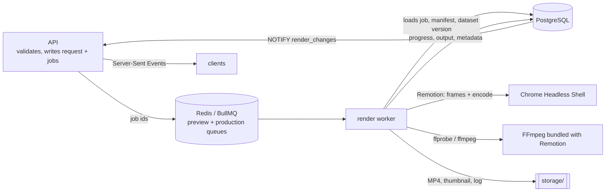

# Render worker

`services/render-worker` turns render jobs into video files. The API publishes jobs and
BullMQ delivers them. The worker renders each job with Remotion, post-processes and checks it
with FFmpeg, stores the file locally and records everything in PostgreSQL. The worker writes the
state it observes itself. The API's monitor only records what a dead worker cannot (see
[Crashes and recovery](#crashes-and-recovery)).



## Job types

A submission is a **render request** with one job per output file:

| Request     | Jobs                               | Queue      | Resolution        | GL                   |
| ----------- | ---------------------------------- | ---------- | ----------------- | -------------------- |
| `preview`   | One per requested format           | preview    | 720p              | Chrome default       |
| `long_form` | One 16:9 job                       | production | Project's setting | `swangle` (software) |
| `short`     | One 9:16 job                       | production | Project's setting | `swangle`            |
| `both`      | A 16:9 and a 9:16 job, independent | production | Project's setting | `swangle`            |

A `both` request's jobs are retried, cancelled and completed independently, and the request
reports their aggregate progress (`GET /api/renders/:id`, `GET /api/renders/:id/events`).

## Pipeline

The queue payload contains only identifiers (`renderJobId`, `requestId`, `projectId`, `kind`,
`outputFormat`). For every attempt the worker:

| #   | Step                     | Status            | What happens                                                                                                                                        |
| --- | ------------------------ | ----------------- | --------------------------------------------------------------------------------------------------------------------------------------------------- |
| 1–2 | Receive, validate        | —                 | Payload checked with `renderJobPayloadSchema`; malformed ones fail permanently. A job cancelled while waiting never starts.                         |
| 3   | Load dataset version     | `validating`      | The manifest's dataset version must be `ready` and its normalized file present.                                                                     |
| 4   | Load project config      | `validating`      | The job, request and manifest (pinned template version and race config) come from PostgreSQL and must match the payload.                            |
| 5   | Verify assets            | `validating`      | The music file must exist with the size and SHA-256 recorded at upload; every other `storage:assets/` reference must exist.                         |
| 6   | Prepare props            | `preparing`       | Rebuilds `{ dataset, config }`, validates it with `barChartRacePropsSchema` and compares its SHA-256 (canonical JSON) with the manifest's checksum. |
| 7   | Select composition       | `preparing`       | `selectComposition` with the props (uploaded assets are served to Chrome by a local, read-only asset server).                                       |
| 8   | Duration and frame count | `preparing`       | `planRaceRender` (shared with the renderer and API) gives size, fps and frames; the composition must match exactly.                                 |
| 9   | Render                   | `rendering`       | `renderMedia` into the job's private temp directory: H.264, yuv420p, AAC, fixed CRF and preset per kind. Progress follows the frames.               |
| 10  | Post-process             | `post_processing` | Moves the MP4 index to the front (`+faststart`, stream copy, bit-exact) if Remotion did not; measures loudness (EBU R128 via `loudnorm`).           |
| 11  | Validate output          | `post_processing` | ffprobe: MP4, H.264, yuv420p, exact size, fps and frame count, audio when music was set. Then a full decode of every frame and sample.              |
| 12  | Metadata                 | `post_processing` | Thumbnail (last chart frame), SHA-256, timings per stage, CPU time, peak memory, versions, worker id.                                               |
| 13  | Store                    | `completed`       | The file is published with a no-clobber hard link, then the output row and `completed` are written in one transaction.                              |
| 14  | Notify                   | —                 | PostgreSQL notifies the API (`NOTIFY render_changes`); BullMQ gets progress and the result.                                                         |

Progress: 0–2 % validating, 2–5 % preparing, 5–85 % rendering, 86–99 % post-processing.
Progress is written to PostgreSQL every 2 %, and a log entry is added every 10 % and at each
stage.

### Files

| What                | Where                                                                  |
| ------------------- | ---------------------------------------------------------------------- |
| Long-form           | `storage/renders/long/<projectId>_long_v<version>.mp4`                 |
| Shorts              | `storage/renders/shorts/<projectId>_short_v<version>.mp4`              |
| Preview             | `storage/renders/previews/<projectId>_<format>_v<version>_preview.mp4` |
| Thumbnail           | `storage/thumbnails/<same name>.jpg`                                   |
| Render log (NDJSON) | `storage/logs/<same name>.log`, every attempt appended                 |
| Working directory   | `storage/temp/renders/<renderJobId>/`                                  |

- **Names.** The version is the project's render counter, so a re-render never reuses a name.
  User-supplied titles never appear in file names.
- **No overwrites.** Files are published with `link()`, which fails if the target exists, so a
  finished video is never overwritten. Readers see either no file or the complete one.
- **Temp files.** The working directory is emptied when an attempt starts and removed when it
  ends, whatever the outcome. Files published by an attempt that did not complete are deleted.
  At start-up, working directories older than `TEMP_RETENTION_HOURS` are removed.
- **Large files.** Video files are streamed for checksums and downloads, never read into memory.
  Uploaded music is streamed to Chrome with HTTP ranges.

## States and transitions

```
pending → validating → preparing → rendering → post_processing → completed
```

- **Other moves.** Any unfinished job may fail, be cancelled, go back to `pending` (waiting for
  a retry, or handed back by a stopping worker) or restart at `validating` (a new attempt).
- **Finished jobs never change.** The rule is `canTransitionRenderJob` in
  `@statsopedia/shared-types`. A PostgreSQL trigger enforces the same rule, so even a stray
  query cannot mark a failed job completed, or complete a job without a stored output.
- **Lock order.** Every status change locks the project row, then the job row. Concurrent
  transitions therefore never deadlock, and the project status is derived from a consistent
  view.

## Failure handling

| Error                                                                                                                                                                   | Retried?                        | Notes                                                                                                              |
| ----------------------------------------------------------------------------------------------------------------------------------------------------------------------- | ------------------------------- | ------------------------------------------------------------------------------------------------------------------ |
| `RENDER_FAILED`                                                                                                                                                         | Yes                             | Browser crash, Remotion error, anything unknown                                                                    |
| `RENDER_TIMEOUT`                                                                                                                                                        | Yes                             | Attempt exceeded `RENDER_TIMEOUT_MINUTES` / `PREVIEW_TIMEOUT_MINUTES`, or a frame exceeded `FRAME_TIMEOUT_SECONDS` |
| `OUTPUT_INVALID`                                                                                                                                                        | Yes                             | ffprobe mismatch or decode errors                                                                                  |
| `STORAGE_FAILED`                                                                                                                                                        | Disk full: yes. Permissions: no |                                                                                                                    |
| `DATABASE_FAILED`                                                                                                                                                       | Yes                             | Connection loss, serialization failure                                                                             |
| `INVALID_PAYLOAD`, `JOB_NOT_FOUND`, `DATASET_NOT_READY`, `DATASET_MISSING`, `ASSET_MISSING`, `INVALID_PROPS`, `PROPS_MISMATCH`, `COMPOSITION_MISMATCH`, `OUTPUT_EXISTS` | No                              | Input or state no retry can fix                                                                                    |

- **Retried failures.** A retryable failure with attempts left moves the job to `pending` and
  logs `Attempt n of m failed (CODE): message; retrying`. BullMQ retries after a backoff: finals
  get 3 attempts with exponential backoff from 30 s, previews 2 attempts 10 s apart.
- **Final failures.** A permanent failure, or one on the last attempt, moves the job to
  `failed`. The job keeps `errorCode` and the original `errorMessage`.

### Cancellation

The API sets a Redis flag and publishes the job id.

- **Waiting jobs.** A job still in the queue is removed at once.
- **Running jobs.** The worker running it aborts Remotion, removes its temporary and partial
  files and records `cancelled`.
- **Never again.** Every attempt checks the flag first, so a cancelled job never starts again.

### Crashes and recovery

- **Worker killed** (`kill -9`, OOM, power loss): its job's BullMQ lock is no longer renewed.
  After about `LOCK_DURATION_SECONDS + STALLED_INTERVAL_SECONDS` (90 s by default), another
  worker picks the job up and starts again at `validating`. A crash does not use up an attempt.
  The API's monitor logs "The render worker stopped responding". If the same job stalls a second
  time, it fails as `WORKER_CRASHED`.
- **Orphaned browsers.** A killed worker leaves its headless Chrome running (Chrome detaches
  into its own process group). At start-up, before opening any browser of its own, a worker
  kills Remotion Chrome processes whose parent is PID 1. That parent means their worker is gone.
  This is skipped on Windows, and when the worker itself is PID 1 (a container), where the
  container's exit cleans up.
- **Graceful stop** (`SIGTERM`): active renders are cancelled and their jobs go back to the
  queue as `pending` without using an attempt. If Redis is unreachable, the worker exits and the
  jobs are recovered as stalled. A second signal forces exit.
- **Jobs submitted while no worker runs** wait in Redis as `pending` and start when a worker
  does.
- **Lost queue entries.** If a job PostgreSQL considers unfinished disappears from Redis for
  more than a minute, the API's monitor re-queues it.

## Configuration

`services/render-worker/.env` (see `.env.example`):

| Variable                                             | Default                            | Purpose                                                  |
| ---------------------------------------------------- | ---------------------------------- | -------------------------------------------------------- |
| `REDIS_URL`, `DATABASE_URL`                          | required                           | Queue and the same database as the API                   |
| `STORAGE_ROOT`                                       | `../../storage`                    | Shared with the API                                      |
| `RENDERER_ENTRY_POINT`                               | `../../apps/renderer/src/index.ts` | Bundled once per process: restart after renderer changes |
| `RENDER_CONCURRENCY`                                 | `1`                                | Production renders at a time                             |
| `PREVIEW_CONCURRENCY`                                | `1`                                | Preview renders at a time (separate queue)               |
| `REMOTION_CONCURRENCY`                               | Remotion's (half the CPUs)         | Browser tabs per render                                  |
| `RENDER_TIMEOUT_MINUTES` / `PREVIEW_TIMEOUT_MINUTES` | `60` / `15`                        | Attempt time limit                                       |
| `FRAME_TIMEOUT_SECONDS`                              | `120`                              | `delayRender` limit per frame                            |
| `FFMPEG_BINARIES_DIR`                                | Remotion's bundled binaries        | Directory with `ffmpeg` and `ffprobe`                    |
| `WORKER_ID`                                          | `hostname:pid`                     | Shown in logs and render metadata                        |
| `TEMP_RETENTION_HOURS`                               | `24`                               | Age at which leftover working directories are removed    |
| `LOCK_DURATION_SECONDS` / `STALLED_INTERVAL_SECONDS` | `60` / `30`                        | Crash detection (see above)                              |

- **Chrome.** Chrome Headless Shell is downloaded by Remotion (`ensureBrowser`) on first use.
- **FFmpeg.** Remotion's compositor package ships FFmpeg and ffprobe. Its build has `loudnorm`
  but not `ebur128`, so loudness is measured with `loudnorm`. No system FFmpeg is needed.

## Determinism

Final renders use:

- software GL (`swangle`)
- fixed encoder settings (CRF 18, preset `medium`)
- the bundled fonts
- props that the worker has checked against the checksum recorded at submission

The end-to-end suite checks that rendering the same request twice produces byte-identical MP4
files. Previews trade this for speed: Chrome's default GL, CRF 23, preset `veryfast`.

## Tests

- **`pnpm --filter @statsopedia/render-worker test`.** Covers:
  - the processor's outcomes (retry, last attempt, permanent failure, cancel, shutdown,
    timeout)
  - error classification
  - no-clobber publishing and temp isolation
  - MP4 box, ffprobe and loudness parsing
  - output validation
  - orphaned-browser detection
  - the asset server and configuration
- **API integration suite** (`TEST_DATABASE_URL`, `TEST_REDIS_URL`). Runs the real worker
  runtime in-process, with Remotion and FFmpeg replaced. It covers:
  - both formats from one project, and previews
  - idempotency
  - retries, invalid output, a permanent mismatch and a changed dataset file
  - a crashed worker recovered by another
  - cancellation of queued, active and whole requests
  - the transition trigger, checked against the TypeScript rule
  - both SSE streams
- **Real rendering** (`RENDER_E2E=1` plus the two URLs, about 1.5 minutes).
  `apps/api/test/render.e2e.test.ts` renders and checks that the results play:
  - a preview
  - a `both` request, re-rendered to check determinism
  - an active render that is cancelled
  - a render that crashes mid-way and is retried
  - a worker process that is killed with `SIGKILL` mid-render, with the job recovered by a new
    worker process, which also reaps the dead worker's browser
